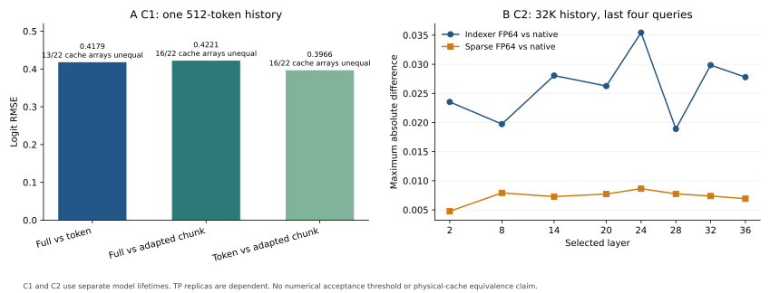

# DeepSeek-V4.1-Flash-1017 physical-cache and lifecycle supplement

Snapshot: 2026-11-10. Revision `1bae0e1088993b9b82de08f59de5be5a34e42170`. This local increment completes the bounded GPU C1/C2 replay and prospective Core lifecycle repair described here. The authorized NPU physical-state supplement awaits connection recovery. Numerical acceptance remains unspecified.

## Findings

C1 retains 2,104 scientific files, 512 cache snapshots and 1,408 native-byte arrays across eight ranks. The captured initialized/reachable domains differ between full, token and adapted chunk execution. C1's original model run timed out at its continuation-review gate after recording these arrays; its failed terminal is preserved. Later raw review and isolated replay succeeded.

| Retained rank-0 contrast | Logit RMSE | Unequal cache arrays | Full129280 probability RMSE |
|---|---:|---:|---:|
| original-full512 / original-token512 | 0.417914751141 | 13/22 | 4.89461983293e-08 |
| original-full512 / adapted-chunk512 | 0.42206709469 | 16/22 | 1.72227027392e-07 |
| original-token512 / adapted-chunk512 | 0.396618848989 | 16/22 | 1.90788118233e-07 |

The retained query has matching top1 for these three contrasts. Eight full-vocabulary TP replicas represent one dependent logical sample. `per_position` JS uses the top100 union plus merged tail, with full-vocabulary normalization; separately named full129280 probability metrics use all vocabulary entries. No topk renormalization is performed. Raw-logit and probability differences have different meanings and scales. Physical-cache equivalence has not been established.

C2 is a separate model lifetime. Its completed 32K capture binds compressor outputs, actual key-cache aliases, projected queries, native indexer scores/selections and sparse-attention operands within that live execution. It covers layers2/8/14/20/24/28/32/36 and query positions32764–32767. Eight ranks retain 181 arrays each, totaling3,451,611,584 native payload bytes. The portable closure preserves1,448 original array paths using592 unique NPY files, plus eight heads and unchanged metadata.

Independent full raw replay checks64 aliases and64 key-cache reuse bindings. Native own-score diagnostics cover32 top512 selections and four candidate-source queries, allowing legal cutoff ties and retaining the newest block. Measured per-layer maximum absolute differences are0.0189015269–0.0354422331 for FP64 global indexer scores versus native, and0.00475973034–0.00863352717 for sparse FP64 versus native. These are descriptive differences. Projection/pooling arithmetic is not recomputed; RoPE/quantization snapshots have integrity checks. The scope does not cover every history query or arithmetic at all40 layers.

## Portable replay

Both C1 and C2 have fresh empty-cwd, isolated Python independent replays. Original arrays and metadata are unchanged. Repeated local results are exact. C1 compares840 derived float fields with336 low-bit differences from the original host, maxabs2.2737367544323206e-13. C2 compares1705 float semantic fields with707 low-bit differences, maxabs6.821210263296962e-13;13652 other fields match exactly. The full difference lists remain with private immutable audit receipts. These differences do not define a numerical tolerance.

## Prospective lifecycle repair

The first new Core placement final was recorded, but its original native-shutdown return flag remainedfalse. Native logs establish a five-second parent process-manager grace followed by forced Core termination while waiting for eight workers. The strict lifecycle audit correctly rejected that evidence.

The case successor changes the cleanup call to the installed native `shutdown(timeout=60)` interface, updates the driver service pin, and freezes the new source. Twenty other runtime files and numerical arithmetic remain unchanged. Native-AST red/green tests preserve finite timeout behavior; complete source/runtime/resource checks precede the new8GPU/TP8/EP8 onepilot.

The new original Core event records a successful native return after9.48606514930725s. Strict source-bound and independent isolated audits pass for parent/Core/eight initialized-worker receipts. Parent/Core mappings are closed; eight data-worker receipts retain mappings for live pair aliases until native worker exit. Exact owned Job/Pod namespace destruction is separately verified. This is not a host-wide PID absence claim.

The bounded run performs one128-token formal job,160 actual post-FFN logical coordinates over40 boundaries, and32 final39 FP64 capsules. Final39 measured maxabs is1.939197328872979; no threshold is supplied. Configuration offload4294967296 bytes, constructor counter4539841592 bytes, and actual per-rank HOST storage4561657912 bytes remain distinct. Historical Core77 missing-final and Core117 failed lifecycle evidence remain unchanged. This prospective repair does not repair their historical receipts.

## Scope retained and remaining work

OriginalGPU191/275, originalNPU269/275 and the separate adapted paired275/275 remain distinct. Existing SGLang277 across five Engine lifetimes and vLLM216 in one TP8/EP8 Engine are reused. This supplement does not rerun216 jobs or establish backbone training; output-head95 is output-head adaptation. All12 prior scientific gaps are preserved verbatim in `summary.json` and the earlier report. Hardware-only causality and numerical acceptance are not claimed.

The NPU endpoint failed three read-only SSH connection attempts at its gateway. Installed compressor/ring-kernel admission and the minimal512 physical-state probe remain pending; no NPU model was started. The recurring automation stays paused at the user's request.

`summary.json` supplies exact values, scope flags and immutable source SHA256 identifiers. The writing-package verifier checks exported bytes; independent raw numerical replay is recorded separately in the case.
