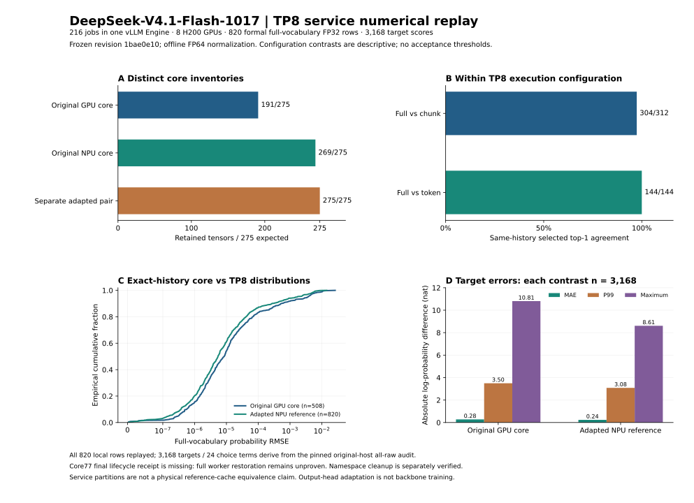

# DeepSeek-V4.1-Flash-1017: configuration-scoped GPU/NPU precision evidence

Actual SGLang review covers 277 whole tasks across separate Engine lifetimes, 531 represented generate calls, 800 formal probability rows, 3,168 target coordinates and 24 candidate terms. TP8 vLLM completed 216 original jobs in one Engine lifetime; original-host review verifies all 3,814 selected raw prediction positions and isolated local replay verifies all 820 formal full-vocabulary rows. These are separate service inventories.

Original GPU reference coverage is 191/275 tensor observations; original NPU reference coverage is 269/275. Separately adapted paired coverage is 275/275 and does not replace either original configuration. Both retained original references cover all 3,168 frozen target coordinates. The 95-call output-head study uses a frozen backbone and does not demonstrate backbone training.

The vLLM numerical audit explicitly retains a lifecycle limitation: EngineCore PID 77 has no final restoration receipt. All eight initialized data-worker finals exist and exact scheduler namespace destruction is verified, but full worker method/mapping restoration remains unproven. The original strict lifetime review remains failed. This additional nonnumerical limitation is separate from the twelve scientific gaps below.

The model revision is `1bae0e1088993b9b82de08f59de5be5a34e42170`. Stored FP8, FP4 and UE8M0 representations, actual runtime arithmetic and the separate adapted references must be interpreted at their recorded configurations. Conversion equivalence does not prove backend arithmetic equivalence.

## Actual configurations and scope

### sglang

Actual earlier settings snapshot; stage bounded-missing-original-task-ready. Each of 277 manifest-pinned task metadata binds this same settings hash. This snapshot is not terminal metadata; union spans separate Engine lifetimes.

```json
{
  "dtype": "auto",
  "tp_size": 4,
  "device": "cuda",
  "trust_remote_code": true,
  "disable_cuda_graph": true,
  "mem_fraction_static": 0.88,
  "max_running_requests": 1,
  "context_length": 33024,
  "chunked_prefill_size": 256,
  "disable_radix_cache": false,
  "cpu_offload_gb": 0,
  "ep_size": 4,
  "speculative_algorithm": null
}
```

### vllm

Actual same-lifetime TP8 firstpilot settings, bound to ready receipt retained in original native manifest; EP enabled,4 GiB CPUoffload, full model original revision.

```json
{
  "tensor_parallel_size": 8,
  "trust_remote_code": true,
  "max_model_len": 32769,
  "max_num_seqs": 1,
  "max_num_batched_tokens": 32768,
  "enforce_eager": true,
  "async_scheduling": false,
  "gpu_memory_utilization": 0.9,
  "enable_expert_parallel": true,
  "enable_prefix_caching": false,
  "tokenizer_mode": "deepseek_v41",
  "limit_mm_per_prompt": {
    "image": 0
  },
  "engram_config": {
    "cpu_offload": true,
    "dp_shared_memory": false
  },
  "cpu_offload_gb": 4,
  "safetensors_load_strategy": "lazy",
  "scheduler_cls": "vllm_core_capture.ReferencePartitionScheduler"
}
```

All distribution metrics use the complete vocabulary; no top-k renormalization is applied. vLLM raw FP32 logits are normalized offline with shared FP64 log-sum-exp. Exact same-history comparisons are descriptive and dependent; divergent autoregressive histories are not paired as the same history. GPU is not a mathematical oracle, no acceptance threshold was declared, and hardware-only causality is not established. Service partitions do not establish physical reference-cache equivalence.

The original-host SGLang portable replay exactly matches its pinned summary. On macOS, 195 of 3,763 floating fields differ, with maximum absolute difference 1.1102230246251565e-16; nonfloating fields agree, and repeated local replay is exact. This is a recorded cross-platform rounding observation, not an acceptance threshold.

## Bounded component evidence

The Engram eight-rank fixture records TP8 metadata; this alone does not prove that the fixture executed native tensor-parallel process groups. The separate TP1 native MARLIN/UVA study covers 20,480 values per arm. It is a bounded component result, not a full-model result or evidence of a 4 GiB memory saving. Full-model offload configuration and measured component allocation are separate quantities.

## Source-bound descriptive measurements

| Service | Contrast | Metric pointer | Value | Unit |
|---|---|---|---:|---|
| sglang | original_GPU | `/core_configuration_contrasts/original_GPU/target_metrics/nll_abs_diff_nat_per_token` | 0.021570104704305537 | nat/token |
| sglang | original_GPU | `/core_configuration_contrasts/original_GPU/target_metrics/mae_nat` | 0.2738695595388386 | nat |
| sglang | original_GPU | `/core_configuration_contrasts/original_GPU/target_metrics/p99_nat` | 3.3730182230810626 | nat |
| sglang | adapted_NPU_reference | `/core_configuration_contrasts/adapted_NPU_reference/target_metrics/nll_abs_diff_nat_per_token` | 0.02692753715396079 | nat/token |
| sglang | adapted_NPU_reference | `/core_configuration_contrasts/adapted_NPU_reference/target_metrics/mae_nat` | 0.25869677818657233 | nat |
| sglang | adapted_NPU_reference | `/core_configuration_contrasts/adapted_NPU_reference/target_metrics/p99_nat` | 3.102715285655603 | nat |
| vllm | original_GPU | `/core_configuration_contrasts/original_GPU/target_metrics/nll_abs_diff_nat_per_token` | 0.002708894839287268 | nat/token |
| vllm | original_GPU | `/core_configuration_contrasts/original_GPU/target_metrics/mae_nat` | 0.27593624760505886 | nat |
| vllm | original_GPU | `/core_configuration_contrasts/original_GPU/target_metrics/p99_nat` | 3.4960450922680324 | nat |
| vllm | adapted_NPU_reference | `/core_configuration_contrasts/adapted_NPU_reference/target_metrics/nll_abs_diff_nat_per_token` | 0.0026485376103679847 | nat/token |
| vllm | adapted_NPU_reference | `/core_configuration_contrasts/adapted_NPU_reference/target_metrics/mae_nat` | 0.23504396060710997 | nat |
| vllm | adapted_NPU_reference | `/core_configuration_contrasts/adapted_NPU_reference/target_metrics/p99_nat` | 3.0849190666305533 | nat |

Every table value resolves to the exact aggregate JSON pointer in [metric-pointers.json](metric-pointers.json); [service-metrics.csv](service-metrics.csv) retains the full numeric metric inventory. Denominators follow their source fields and are not independent sample counts.

## Scientific figure



The standard Matplotlib figure uses pinned actual summary data and passed a separate visual review. Its ECDF rows, full/chunk and token denominators and 3,168 target errors are documented in [figures/plot-data.json](figures/plot-data.json). No confidence interval or acceptance threshold is inferred.

## Preserved scientific gaps

| Gap | Classification | Evidence and continuation meaning |
|---|---|---|
| original-core-84 | actual native interface rejections | The original GPU capture retains 191 of 275 observations: 78 multi-token reference-cache observations and six masked-padding observations are missing after native interface rejections. The original NPU capture retains 269 of 275 observations and lacks the same six padding observations. The separately adapted paired 275-observation result does not alter either original capture. |
| backbone-autograd | actual complete model backward rejections | Complete-model, finite 128-token forward calls reached backward attempts on four GPUs and eight NPUs, then rejected inference paths without the required gradient graph. This does not supply full-backbone LoRA, optimizer-update, clipping, checkpoint, SFT or RL evidence. The output-head study keeps the backbone frozen. |
| trainer-trl-verl | actual CPU registration rejections | Eight actual constructors across the two peers rejected the deepseek_v41 Transformers registration. These are CPU compatibility results. Accelerator training requires a model-registration and autograd adaptation before its numerical behavior can be tested. |
| official-npu-entrypoint | actual exact route rejections | The original generate.py invocation rejected torch.cuda.set_device on the NPU route; the tested act_quant call rejected TileLang target autodetection. These exact routes do not provide official full-model NPU numerical results, and the failures do not establish that every NPU implementation is unsupported. |
| npu-sglang-entrypoint | actual exact route rejections | The tested HostTable registration and eight-argument NPU Engram gather retained CUDA assumptions and rejected the actual calls. This route has no full Engine numerical result; the finding is limited to the tested source and invocation. |
| indexed-sparseflashmla | actual exact ABI rejection | Native metadata construction succeeded, but the indexed kernel rejected the tested ori_sparse_indices ABI branch. Compressed layer-2 and layer-20 calls were not executed after that failure. Separate adapted attention results do not resolve this exact native interface. |
| strict-layer2-vjp | actual exact local derivative rejection | Strict local layer-2 compressor pool and normalization VJP calls remain rejected at 2K and 32K. Bounded target diagnostics and other selected derivatives do not close this original derivative branch; an independently justified implementation is still required. |
| original-default-npu32k | unexecuted original resource admission scope | The original default, unchunked 32K dense-head configuration was not executed in this cohort. A source-based memory-admission estimate is not an observed physical out-of-memory failure. Adapted attention and HTTP results cover different configurations. |
| physical-reference-cache-teacher | unmeasured equivalence scope | Physical cache partition and alias equivalence remain unproved, as does fresh-HTTP versus cached-teacher equivalence. Successful adapted teacher comparisons do not establish that the original physical cache behaves identically. |
| same-live-upstream-query-key-chain | unmeasured composition scope | Serialized native compressor-to-key capsules, retained query-to-indexer work and selected cross-layer diagnostics exist. They do not demonstrate one live, integrated compressor, key, query and native-score chain. |
| full-history-allTP-ownscore | unretained coordinate scope | Attention replay retains selected rank-0 tail queries; selector studies retain four tail queries per case. Unsaved full-history queries, arithmetic for other tensor-parallel ranks and native score arrays cannot be reconstructed from the retained files. |
| hardware-only-cause-acceptance | undeclared or confounded claim | Arithmetic, tensor and expert parallelism, offload and software configurations differ. No numerical acceptance threshold was declared. GPU results are comparison peers rather than mathematical ground truth, so differences alone do not establish a hardware-only cause. |

The full prior English report remains available as the [original precision report](../deepseek41-precision-report.md). It is a historical snapshot; dated pending statements there do not override the current service results above. Current source bindings, scientific gap records and the distinct Core77 limitation are retained in this package. Further training, missing physical-cache equivalence and full-chain arithmetic scopes are not marked complete.

Aggregate source files are [sglang.json](sources/sglang.json) and [vllm.json](sources/vllm.json). The exact scientific gap authority is [preserved-scientific-gaps.json](preserved-scientific-gaps.json), and the separate lifecycle limitation is [lifecycle-gaps.json](lifecycle-gaps.json).
