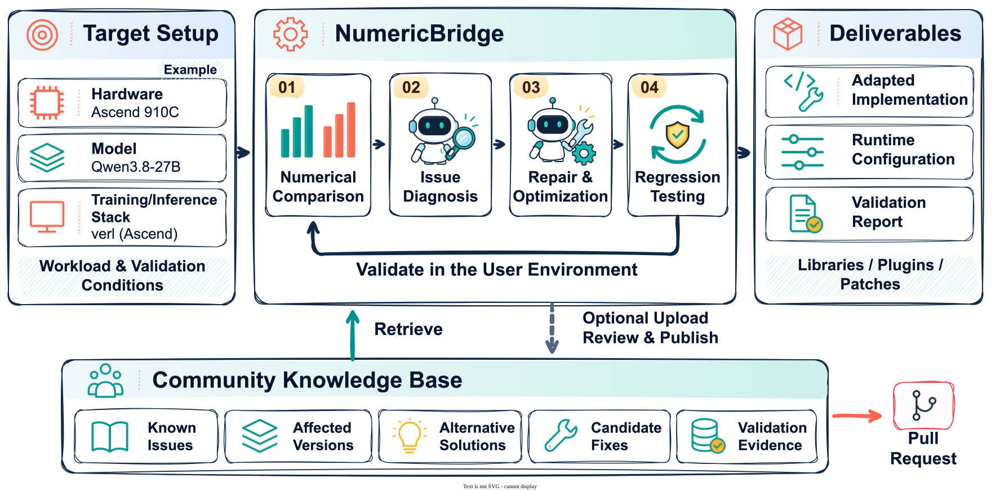

<p align="center">
  
</p>

<h1 align="center">NumericBridge</h1>

<p align="center">
  <a href="LICENSE"></a>
  <a href="https://github.com/satsuki2486441738/NumericBridge/actions/workflows/ci.yml"></a>
  <a href="https://satsuki2486441738.github.io/NumericBridge/"></a>
  <a href="https://github.com/satsuki2486441738/NumericBridge/stargazers"></a>
</p>

<p align="center"><strong>Numerical precision comparison, diagnosis and repair</strong></p>

<p align="center">English · <a href="README.zh-CN.md">简体中文</a></p>

<p align="center"><a href="#framework-overview">Overview</a> · <a href="#getting-started">Getting started</a> · <a href="#typical-cases">Typical cases</a> · <a href="#evaluation-and-repair-history">Results and repair history</a></p>

NumericBridge is a community for investigating numerical precision across inference and training stacks, including RL. Start by querying the live community case library for records that match your setup, then deploy the workload locally to reproduce and diagnose precision differences. Verify the fix by rerunning the original workload and share the patch and evidence with the community in a pull request.

## Framework overview



*The Ascend 910C / Qwen3.8-27B / verl configuration in the figure is an example. See [Typical cases](#typical-cases) for measured results and verified coverage.*

Search the [community case library](https://satsuki2486441738.github.io/NumericBridge/index.html#/cases) by hardware, model and framework version to retrieve known issues, candidate fixes and prior measurements. In your own environment, compare the affected outputs, gradients or weight updates before and after the change. Include the configuration, patch and measured coverage in the pull request so the next team can reproduce the result.

## Getting started

Clone the repository and export the skills to a fresh directory. Point your agent client at the exported skills, or use its skills directory as the output path. Precision Compare includes the shared tools and an offline snapshot of the community case library. [Installation and updates](tools/README.md#portable-skills)

```sh
git clone https://github.com/satsuki2486441738/NumericBridge.git
cd NumericBridge
python -B -m scripts install --output ../numericbridge-skills
```

**Look up a case.** From the repository root, fetch the current community index and return one record for PEFT. Substitute the library used by your workload.

```sh
python -B -m tools.community_search \
  --index https://satsuki2486441738.github.io/NumericBridge/data/search-index.json \
  --library peft --limit 1
```

**Run a first comparison.** With PyTorch and NumPy installed, run this CPU example from the repository root. It uses the same classifier, weights and batch for two backward passes, one in FP32 and one in BF16. The output gives the gradient differences and the path to both captures and `report.json`.

```sh
python skills/precision-compare/examples/compare_gradients.py
```

For your own workload, give the agent the run commands or saved artifacts from both sides. For example, “Compare the gradients and stored weight updates in these two runs. Show which parameters were compared and which had the largest differences.”

## Skills and guides

| What do you need? | Skill | What you get |
| --- | --- | --- |
| Run a workload on a new backend | [Framework Adapt](skills/framework-adapt/SKILL.md) | A working configuration and a native run on the target stack |
| Find where two runs diverge | [Precision Compare](skills/precision-compare/SKILL.md) | Paired measurements, coverage and the locations of differences |
| Diagnose a difference and fix a confirmed defect | [Precision Repair](skills/precision-repair/SKILL.md) | A diagnosis with supporting evidence and, for a confirmed fix, a patch tested on the original workload |

Choose the guide for the quantity you want to compare. The inference guide covers token distributions on a shared history. The SFT guide covers gradients and optimizer updates. The RL guide covers action scores and losses on fixed trajectories. [Inference](skills/precision-compare/references/inference.md) · [SFT](skills/precision-compare/references/sft.md) · [RL](skills/precision-compare/references/rl.md)

## Typical cases

| Workload | What the measurements showed | Evidence |
| --- | --- | --- |
| Qwen3.5-9B-Base · LoRA | On the first training step, cosine similarity across GPU and NPU was about 0.9976 for gradients and 0.9775 for stored weight updates. | [Training measurements](reports/qwen35-precision-report.md) |
| Qwen3.8-Flash-Next · inference | With automatic placement on GPU and TP8 on NPU, the top token matched in 254 of 264 sampled full-forward rows and 2 of 32 later fixed-history rows. The runs included 32K inputs. Native NPU vLLM and SGLang failed during initialization, before scoring. | [Inference report](reports/qwen38-precision-report.md) |
| DeepSeek-V4.1-Flash-1017 · GPU/NPU comparison | The original comparison paired 191 of 275 tensor observations and all 3,168 target scores. A later, separately adapted configuration paired 275 of 275 observations. | [Original comparison](reports/deepseek41-precision-report.md) · [Follow-up report](reports/deepseek41-services-final-20261109/report.md) |
| PEFT 0.17.1 · LoRA adapter merging | SVD combination applied the adapter scale twice. After backporting the upstream fix, all 24 small CPU workloads passed, including forward, input-gradient and checkpoint checks. | [Repair record](community/site/evidence/peft-lora-svd-scaling.md) · [Patch](community/site/evidence/peft-lora-svd-scaling.patch) |

The three model comparisons report measurements for the configurations tested. Numerical acceptance thresholds were unspecified. [Browse all reports](reports/README.md)

## Evaluation and repair history

Use the [community case library](https://satsuki2486441738.github.io/NumericBridge/index.html#/cases) to select your model, hardware and framework version. Open a matching case to see the observed difference, candidate fixes and the workload used to verify each tested fix.

- [History archive](https://satsuki2486441738.github.io/NumericBridge/archive.html) — look up earlier evaluations and repairs by configuration.
- [Results and evidence](https://satsuki2486441738.github.io/NumericBridge/paper.html) — find the figures, measured values and source records behind a report.

## Contributing

To share a comparison or repair, open a pull request with the model and library revisions, run configuration, observed difference and evidence. For a fix, include the before-and-after results on the original workload. [Community record guide](skills/precision-compare/references/community-records.md) · [Publication guidelines](docs/publication.md)

Before submitting, run the repository and record checks from the repository root. [Developer guide](AGENTS.md)

```sh
python -m pip install -r requirements-dev.txt
python -B -m scripts validate
python -B -m community.records validate
```

## Trusted by Industry and Research


[Sun Yat-sen University](https://www.sysu.edu.cn/) · [The Chinese University of Hong Kong, Shenzhen](https://www.cuhk.edu.cn/en) · [Shenzhen Loop Area Institute](https://www.slai.edu.cn/en) · [China Merchants Lion Rock AI Lab](https://lionrocklab.com/) · [AutoKernel](https://autokernel.cn/)
