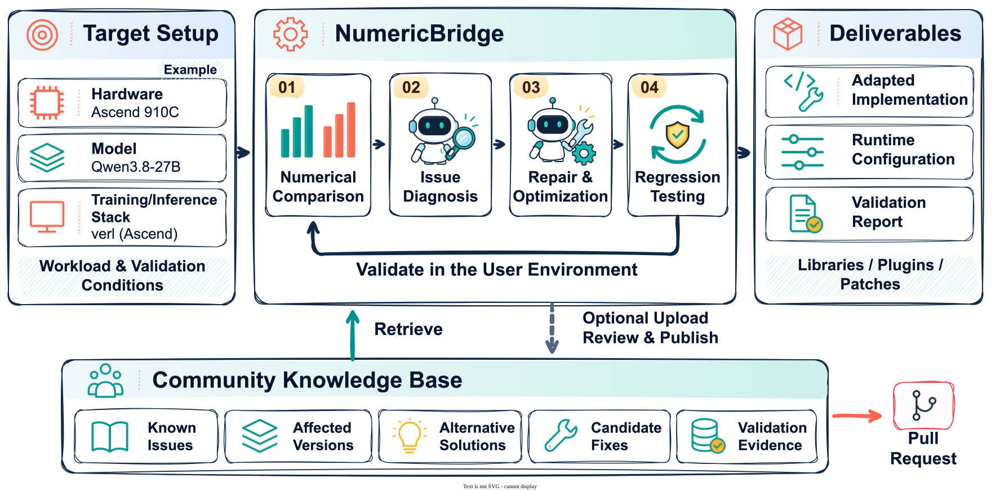

<p align="center">
  
</p>

<h1 align="center">NumericBridge</h1>

<p align="center">
  <a href="LICENSE"></a>
  <a href="https://github.com/satsuki2486441738/NumericBridge/actions/workflows/ci.yml"></a>
  <a href="https://satsuki2486441738.github.io/NumericBridge/"></a>
  <a href="https://github.com/satsuki2486441738/NumericBridge/stargazers"></a>
</p>

<p align="center"><strong>面向推理、训练与强化学习的跨栈精度对齐框架与协作社区</strong></p>

<p align="center"><a href="README.md">English</a> · 简体中文</p>

<p align="center"><a href="#框架概览">框架概览</a> · <a href="#快速开始">快速开始</a> · <a href="#典型案例">典型案例</a> · <a href="#评测与修复历史">评测与修复历史</a></p>

NumericBridge 是一个面向推理、训练和强化学习（RL）的数值精度社区。先按当前配置实时检索社区记录，获取最新的相关案例，再在本地部署工作负载，复现并定位精度问题。修复后，重新运行原始负载验证效果，再把验证结果投稿给社区审核。

## 框架概览



*图中的 Ascend 910C / Qwen3.8-27B / verl 配置仅为示例；实测结果与已验证覆盖范围见[典型案例](#典型案例)。*

按硬件、模型和框架版本检索[社区案例库](https://satsuki2486441738.github.io/NumericBridge/index.html#/cases)，可以找到已知问题、候选修复和已有测量结果。在本地环境中，对比修复前后的输出、梯度或权重更新。投稿时附上运行配置、补丁及实际验证范围，便于遇到同类问题的人复验。

## 快速开始

克隆仓库，将 Skill 导出到新目录。可以让 Agent 客户端从该目录加载 Skill，也可以把输出路径改为客户端的 Skill 目录。Precision Compare 自带共享工具和社区案例库的离线快照。[安装与更新说明](tools/README.md#portable-skills)

```sh
git clone https://github.com/satsuki2486441738/NumericBridge.git
cd NumericBridge
python -B -m scripts install --output ../numericbridge-skills
```

**先查一个案例。** 在仓库根目录运行以下命令，会拉取当前社区索引并返回一条 PEFT 记录。把 `peft` 换成你的工作负载所用的库即可。

```sh
python -B -m tools.community_search \
  --index https://satsuki2486441738.github.io/NumericBridge/data/search-index.json \
  --library peft --limit 1
```

**跑一次梯度比较。** 安装 PyTorch 和 NumPy 后，在仓库根目录运行下面的 CPU 示例。它使用相同的分类器、初始权重和同一批输入，分别用 FP32 和 BF16 做反向传播。输出会列出梯度差异，并给出两份采集结果及 `report.json` 的保存路径。

```sh
python skills/precision-compare/examples/compare_gradients.py
```

自己的任务从 [NumericBridge Skill](skills/numericbridge/SKILL.md) 开始。告诉 Agent 目标硬件、模型、框架和任务，已有运行命令或采集结果也可以一起给它。

## 工作流与 Skill

[工作流](skills/numericbridge/references/workflow.md)按阶段指引 Agent 使用对应 Skill。部署适配用 [Framework Adapt](skills/framework-adapt/SKILL.md)，精度采集与对比用 [Precision Compare](skills/precision-compare/SKILL.md)，出现需要调查的差异时用 [Precision Repair](skills/precision-repair/SKILL.md)。每一步沿用已确认的需求和已有证据。

按要比较的量选择指南。推理指南讲解如何在相同的历史 token 序列上比较输出分布，SFT 指南覆盖梯度和优化器更新，RL 指南则聚焦固定轨迹上的动作评分与损失。[推理](skills/precision-compare/references/inference.md) · [SFT](skills/precision-compare/references/sft.md) · [RL](skills/precision-compare/references/rl.md)

## 典型案例

| 工作负载 | 实测发现 | 证据 |
| --- | --- | --- |
| Qwen3.5-9B-Base · LoRA | 在第一个训练步，GPU 与 NPU 的梯度余弦相似度约为 0.9976，实际权重更新的余弦相似度约为 0.9775。 | [训练测量报告](reports/qwen35-precision-report.md) |
| Qwen3.8-Flash-Next · 推理 | GPU 使用自动分配，NPU 使用 TP8。完整前向的 264 个抽样位置中，有 254 个位置的首选 token 相同。在后续固定历史的 32 个位置中，仅 2 个相同。输入覆盖 32K。NPU 上的原生 vLLM 和 SGLang 在评分前初始化失败。 | [推理报告](reports/qwen38-precision-report.md) |
| DeepSeek-V4.1-Flash-1017 · GPU/NPU 比较 | 原始配置配对了 275 项张量观测中的 191 项，以及全部 3,168 个目标评分。后续单独适配的配置配对了全部 275 项张量观测。 | [原始比较](reports/deepseek41-precision-report.md) · [后续报告](reports/deepseek41-services-final-20261109/report.md) |
| PEFT 0.17.1 · LoRA 适配器合并 | SVD 合并时重复应用了适配器的缩放因子。回移植上游修复后，24 个小型 CPU 负载全部通过，验证覆盖前向、输入梯度和检查点。 | [修复记录](community/site/evidence/peft-lora-svd-scaling.md) · [补丁](community/site/evidence/peft-lora-svd-scaling.patch) |

前三项模型比较均报告所测配置下的数值，未设定精度验收阈值。[浏览全部报告](reports/README.md)

## 评测与修复历史

在[社区案例库](https://satsuki2486441738.github.io/NumericBridge/index.html#/cases)中选择模型、硬件和框架版本。打开匹配的案例，可以查看观测到的差异、候选修复，以及每个已测试修复所用的验证负载。

- [历史归档](https://satsuki2486441738.github.io/NumericBridge/archive.html)可按配置查找既有评测和修复记录。
- [结果与证据](https://satsuki2486441738.github.io/NumericBridge/paper.html)可查阅报告中的图表、实测数值及其来源。

## 参与贡献

通过[社区投稿 MCP](community/README.md#mcp-contribution)分享比较结果或修复案例。请附上模型和依赖库版本、运行配置、观测差异和证据。分享修复时，附上同一原始负载修复前后的结果。社区维护者负责审核、入库和必要的上游 PR。[社区记录指南](skills/precision-compare/references/community-records.md) · [发布规则](docs/publication.md)

提交前，在仓库根目录运行仓库和社区记录检查。[开发指南](AGENTS.md)

```sh
python -m pip install -r requirements-dev.txt
python -B -m scripts validate
python -B -m community.records validate
```

## 产业界与学术界用户


[中山大学](https://www.sysu.edu.cn/) · [香港中文大学（深圳）](https://www.cuhk.edu.cn/) · [深圳河套学院](https://www.slai.edu.cn/) · [招商局狮子山人工智能实验室](https://lionrocklab.com/) · [智子芯元（深圳）科技有限责任公司](https://autokernel.cn/)
