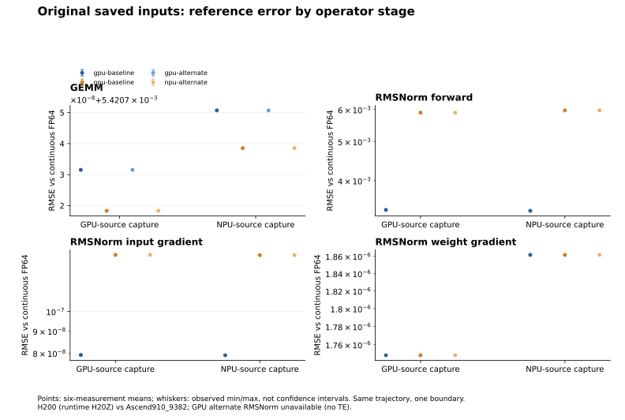
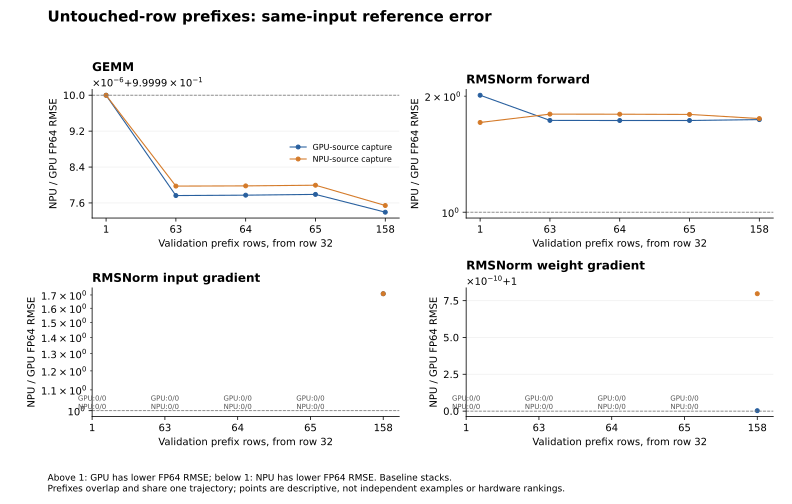
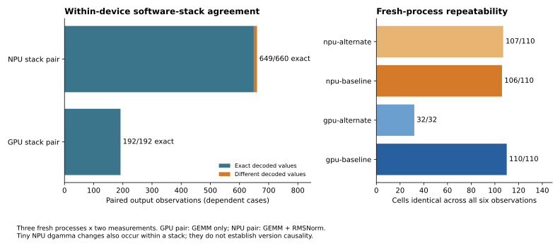
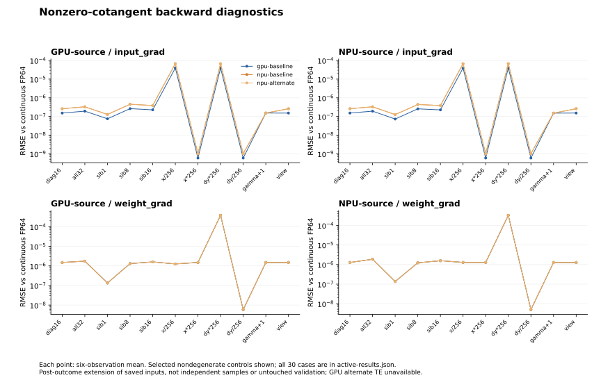

# Same-input operator references and software-stack robustness

Supplement to *Operator-Level Numerical Differences Between NVIDIA and Ascend Accelerators: A Paired Study of Model Execution*. Observed 8 November 2026 UTC. This is a private bounded empirical supplement, not a new model-quality evaluation.

## What this adds

This supplement extends the original saved GEMM and RMSNorm captures with frozen row/reduction/output-size and value controls, independent reference checks, fresh-process repetitions, and one additional software stack per compatible operator path. It separates mathematical reference error, stored-output agreement, execution repeatability and downstream task outcomes. GPU is a peer, not a mathematical oracle.

The GPU is **NVIDIA H200 (runtime-reported H20Z; physical identity confirmed by the user)**. Original and new raw H20Z labels remain preserved. The user's confirmation supersedes the preliminary device-label interpretation; no hardware erratum is asserted. The new GPU cohort and original study are not asserted to share a physical device UUID. The NPU reports Ascend910_9382.

## Design and coverage

The frozen inventory has **58 cases: 32 GEMM and 26 RMSNorm**, with **194 reference arrays**. Each admitted arm has three fresh processes, one warmup and two measurements per process. All expected cases, output stages, raw/native dtype and lossless views are checked against the independent inventory, rather than the peers' intersection. GPU baseline and both NPU arms each cover 110 case-stage cells / 660 measured outputs; GPU alternate covers 32 GEMM cells / 192 measured outputs. Across the four arms this is 362 case-stage cells / 2,172 measured outputs. These counts are inventory coverage, not independent statistical samples.

Two original peer captures come from one trajectory and one normalization/projection boundary, with the original leading shape 95 x 2 x 4096 retained. Diagnostic rows are [0,32); validation rows [32,190) use overlapping prefixes 1/63/64/65/158. Derived K/N/scale/zero/gamma/leading-shape controls add execution conditions, not independent model captures. Gamma+1 represented in BF16 is a quantization-bearing control and is not assumed exactly equivalent.

GEMM uses the exact original BF16 weight shard (shape 3088 x 4096) and native linear operation. Independent FP64 products are assessed both continuously and after direct round-to-nearest-even BF16 conversion, without an intermediate FP32 rounding. All 276 selected math.fsum dot checks agree exactly with the FP64 products. Each complete historical direct-RNE array agrees on 586,720 coordinates. RMSNorm uses pinned FP64 analytical y/dx/dgamma references, backed by bounded finite-difference checks. Tiny native API/math fixtures passed before main capture. Weight gradients retain the actual isolated module .grad dtype; historical model main_grad storage is a separate interface.

| Arm | Torch | Backend stack | Original operator scope |
| --- | --- | --- | --- |
| GPU baseline | 2.9.0+cu126 | CUDA 12.6, TE 2.11.0 | GEMM; TE RMSNorm forward/backward |
| GPU alternate | 2.10.0+cu128 | CUDA 12.8, cuBLAS [private reference removed] | GEMM only; TE absent |
| NPU baseline | 2.9.0+cpu | torch_npu 2.9.0.post2, CANN 9.1.0 | GEMM; corrected native RMSNorm |
| NPU alternate | 2.10.0+cpu | torch_npu 2.10.0.post4, same CANN 9.1.0 | Same original GEMM/RMSNorm path |

NPU driver 25.5.2 and CANN remain unchanged. GPU software dependencies change together; this is a stack comparison, not single-library causality. The isolated alternate NPU environment retains explicitly scoped unused pip dependency conflicts; it is not certified as a complete framework environment. GPU alternate RMSNorm is excluded because compatible TE is absent; no substitute implementation or ABI transplant is used. Numerical libraries actually mapped by each process are hashed in the native receipts. Shared drivers, CANN and historical environments were not mutated.

Policies are highest FP32 matmul precision, TF32/HF32 disabled, deterministic algorithms false, and NPU deterministic level 0. BF16 reduced-precision reduction is enabled on GPU; that common arm field is not an exposed NPU control. The actual effective settings, source, typed operand hashes, exact process identities and device ownership are retained. Both GPU version arms ran sequentially on the same current allocated GPU, verified through unique NVML PCI / CUDA PCI identity, consistent CUDA/Torch UUIDs and effective mask/order. Runtime and allocator UUID aliases are recorded separately.

## Original-capture reference accuracy

The table reports six-observation mean RMSE against continuous FP64. Tiny dgamma min/max variation is retained in results.json. Values across operators/scales should not be pooled into a universal ranking.

| Stage | Source capture | GPU base | NPU base | GPU alt | NPU alt |
| --- | --- | --- | --- | --- | --- |
| gemm/output | gpu | 0.00542073156 | 0.00542071836 | 0.00542073156 | 0.00542071836 |
| gemm/output | npu | 0.0054207507 | 0.00542073854 | 0.0054207507 | 0.00542073854 |
| rmsnorm/output | gpu | 0.00338629273 | 0.00589396832 | not covered | 0.00589396832 |
| rmsnorm/output | npu | 0.00336831128 | 0.00597115339 | not covered | 0.00597115339 |
| rmsnorm/input_grad | gpu | 7.92168781e-08 | 1.35438401e-07 | not covered | 1.35438401e-07 |
| rmsnorm/input_grad | npu | 7.90866793e-08 | 1.35227669e-07 | not covered | 1.35227669e-07 |
| rmsnorm/weight_grad | gpu | 1.74833046e-06 | 1.74833046e-06 | not covered | 1.74833046e-06 |
| rmsnorm/weight_grad | npu | 1.86151881e-06 | 1.86151881e-06 | not covered | 1.86151881e-06 |

Continuous FP64 error and BF16-rounded agreement answer different questions. For the original GEMM captures, these are the mismatched stored coordinates and maximum absolute error against the directly rounded BF16 reference (586,720 coordinates per capture):

| Arm | Source capture | RNE unequal min..max | RNE max abs |
| --- | --- | --- | --- |
| gpu-baseline | gpu | 975..975 | 0.0625 |
| gpu-baseline | npu | 934..934 | 0.0625 |
| npu-baseline | gpu | 112..112 | 0.03125 |
| npu-baseline | npu | 112..112 | 0.03125 |
| gpu-alternate | gpu | 975..975 | 0.0625 |
| gpu-alternate | npu | 934..934 | 0.0625 |
| npu-alternate | gpu | 112..112 | 0.03125 |
| npu-alternate | npu | 112..112 | 0.03125 |

## Expanded condition coverage

The counts below compare per-case six-observation mean continuous-FP64 RMSE on the baseline stacks. Equal means exactly equal scalar RMSE; it does not imply peer outputs are identical. These are dependent case counts, not independent wins, confidence intervals or significance tests. Different dgamma storage/accumulation interfaces must remain visible when interpreting that stage.

| Operator/stage | GPU lower | NPU lower | Equal |
| --- | --- | --- | --- |
| gemm/output | 0 | 30 | 2 |
| rmsnorm/output | 22 | 0 | 4 |
| rmsnorm/input_grad | 4 | 0 | 22 |
| rmsnorm/weight_grad | 4 | 0 | 22 |

The retained cotangent is nonzero only at original flattened rows 156-187. Consequently the initial diagnostic rows, derived controls and short validation prefixes 1/63/64/65 exercise zero backward gradients; only original190 and validation158 include the nonzero cotangent. Those zero-gradient cells are sanity checks, not challenging backward precision coverage. The separately frozen active-cotangent successor is reported separately when complete, without rewriting this original freeze. Undefined 0/0 ratios are annotated rather than plotted as agreement.

Every case is listed with RMSE, maximum absolute error, relative L2, BF16-rounded mismatch counts where applicable, native dtypes and repeatability in [results.json](../sources/operator-original.json). Zero-reference relative L2 is unavailable rather than assigned an artificial value. Scale controls can change absolute errors without showing an implementation defect.

## Software-stack change and repeatability

| Side | Exact observations | Paired observations | Different | Maximum peer abs | Model trigger |
| --- | --- | --- | --- | --- | --- |
| gpu | 192 | 192 | 0 | 0 | not-triggered |
| npu | 649 | 660 | 11 | 4.76837158e-07 | not-triggered |

The 11 NPU differences are dgamma observations, each with one changed coordinate and maximum absolute difference 4.76837158203125e-7. The same dgamma cells also vary within a software stack across repeated measurements/processes. Consequently these tiny differences do not isolate a version effect. Within NPU, unchanged GEMM, y and dx outputs demonstrate bounded robustness to the tested front-end stack intervention with fixed CANN; they do not establish cross-CANN/kernel-library generality or universal exact determinism.

The material-change rule was frozen before native outcomes: a reproducible new nonfinite/semantic failure, or an absolute FP64 RMSE change of at least 1e-5 **and** a relative change of at least 20% on at least two untouched-validation cells of the same operator/stage in all three fresh processes. The per-process statistic is the arithmetic mean of its two measured RMSE values. Neither side triggered it, and no new nonfinite result occurred. Therefore no new affected-path model execution was required by this supplement. This rule prioritizes diagnostics; it is not a numerical acceptance or task-quality threshold.

## Separately frozen nonzero-cotangent backward diagnostics

Inspection of the original packet showed that its nonzero cotangent is confined to rows 156-187. To avoid counting zero-gradient controls as expanded backward stress, a second input inventory was frozen before its own native outcomes, using those exact original cotangents. This addition occurred after the initial outcomes were observed: it is a diagnostic successor, not untouched validation or a new independent capture.

The successor contains **30 RMSNorm cases / 150 references**: active16 rows [156,172), all32 rows [156,188), sibling-row prefixes [172,172+m) for m=1/7/8/9/16, and active16 x/dy power-of-two scales, zero-x/zero-dy, BF16 gamma+1 representation and leading-view controls. Twenty-six nondegenerate cases have nonzero analytical dx and dgamma. Independent finite differences and typed native/reference operand agreement were checked before execution. GPU baseline TE and both NPU stacks each ran three fresh processes with two measurements: **270 case-stage cells / 1,620 measured outputs** in this separate cohort. The initial 58 cases were not rerun on NPU.

| Active RMS stage | GPU lower FP64 RMSE | NPU lower | Equal |
| --- | --- | --- | --- |
| rmsnorm/input_grad | 27 | 1 | 2 |
| rmsnorm/weight_grad | 6 | 9 | 15 |

Counts include explicit zero controls and dependent conditions; they are not independent wins. Across NPU versions, 510/540 decoded-output observations are exact; 30 differ, with maximum absolute difference 7.62939453e-06. Nonrepeatable case-stage cell counts across all six measurements are gpu-baseline: 0, npu-baseline: 12, npu-alternate: 10. Version differences and within-stack repeatability remain separate descriptive quantities; neither is automatically a version-causal or task-quality effect.

The complete condition/stage/native-dtype values and error ranges are in [active-results.json](../sources/operator-active.json). The initial heldout-based material-change rule is not reinterpreted as a test on these post-outcome controls. No new model-quality acceptance criterion or model execution is claimed.

## How to use this in the paper

- Retain the original operator-specific interpretation: reference accuracy can favor different peers at different stages, and peer agreement is not mathematical correctness. Report the new original-input measurements and the dependent controls beside the historical cohort, with exact software configuration.
- Add the tested software-stack robustness result with its operator/runtime boundary. Do not claim that every version, library or accelerator shares the same behavior, or that Torch alone caused a change when dependencies moved together.
- Keep restart repeatability separate. Existing Qwen evidence that NPU native deterministic level 1 reaches 448/448 exact checks makes the historical default-level GPU 448/448 versus NPU 298/448 result configuration dependent. This operator supplement does not rerun checkpoint continuation or extend that count.
- Keep selective FP32 conclusions tied to their original task metrics: lower token RMSE did not guarantee a smaller absolute mean NLL gap. The present GEMM/RMSNorm replays add reference evidence, not a new downstream accuracy or training-quality verdict.
- The strongest supported statement is that numerical differences are operator-, input-, configuration- and metric-dependent, with bounded stability across the compatible software stacks tested here. A platform-wide precision ranking is unsupported.

## Limitations and reproducibility

One boundary, one weight shard and two same-trajectory captures limit external validity. Validation prefixes overlap. Only three fresh processes and two measures were used; their ranges are descriptive, not confidence intervals. The NPU intervention keeps CANN fixed. GPU RMSNorm has no alternate TE arm. No extra independent model/data families, checkpoint continuation, long-context serving, full training or downstream task-quality experiments were run in this supplement. Historical DeepSeek/Qwen deliveries remain closed and scheduled monitoring remains PAUSED.

The source index [retained private evidence or external source; not bundled] pins the frozen inputs/references, approved arm/admission descriptors, each leaf result/raw output, complete exports, cleanup and external analysis. All failures and raw arrays remain in their original runs. Native model/service processes were not launched. Exact operator process/job cleanup and NPU device-idle evidence are independently audited before final delivery.

Run `python -I -B verify.py` in this package to verify every included file against MANIFEST.json. This is a standalone byte-integrity check, not a new numerical replay. `python -I -B replay.py --output [private reference removed]` verifies retained external pins, recomputes both the initial four-arm and successor three-arm analyses with the source-pinned analyzers and compares their canonical results; it requires the retained local source/raw directories listed in source-index.json and imports no device backend. Regenerate SVG/PNG figures with `python -B build_supplement.py --plot-results results.json --output [private reference removed]`. Exact image bytes depend on Matplotlib/fonts; numerical values remain pinned.

Export note: commands mentioning private packages describe the retained private workflow; this aggregate bundle includes only the verifier documented in its root README.
