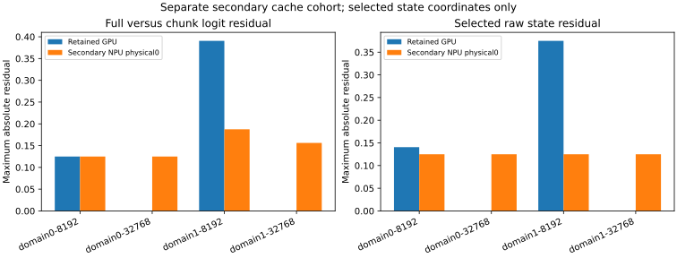
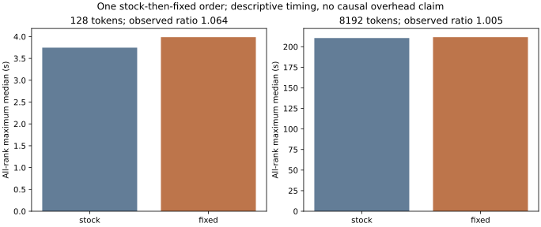

# Qwen follow-up: reviewed existing results and secondary successors

This final scoped private package preserves the independently delivered historical results and adds separately admitted secondary-host observations. The exact candidate package passed independent review and root scope approval; the candidate manifest and approval SHA256 are retained in candidate-provenance.json. Numerical acceptance remains null; no general task accuracy, hardware-only cause, or completion of every numerical chain is claimed.

## Preserved existing evidence

The [historical interim report](qwen-diagnostics.md), [original results](../sources/qwen-followup.json), and [DeepSeek report](deepseek41.md) retain their observation dates, configurations, measurements and known gaps. The original primary-host Q35 cache capture remains not launched. A successful secondary capture does not replace that missing canonical primary result. Previously completed GPU, heldout, backward, and historical TRL matrices were reused.

## Q35 secondary original cache

The retained GPU cache is compared with a separately admitted secondary NPU physical 0 singleton successor. Original primary-host heldout and secondary-host cache are distinct cohorts. Both actual cache captures contain 4 examples, 36 stateful calls and 573440 processed prompt tokens. These are not 36 independent full forwards. Numerical cache-state comparisons cover only predetermined exported raw coordinates; other state tensors have hashes rather than numerical error magnitudes.

| Peer | Selected raw state arrays | Selected bytes | State hash observations |
| --- | ---: | ---: | ---: |
| Retained GPU | 96 | 52199424 | 768 |
| Secondary NPU physical 0 | 96 | 52199424 | 768 |

Actual cache runtime per cohort (revision from its externally pinned contract):

| Cohort | Model revision | Device/model | World size | Dtype | Torch | Torch NPU | Transformers | Attention |
| --- | --- | --- | ---: | --- | --- | --- | --- | --- |
| gpu_cache | 68c46c4b3498877f3ef123c856ecfde50c39f404 | cuda:0 / NVIDIA H20Z | 1 | torch.bfloat16 | 2.9.0+cu126 | None | 5.20.2 | sdpa |
| secondary_npu_cache | 68c46c4b3498877f3ef123c856ecfde50c39f404 | npu:0 / Ascend910_9382 | 1 | torch.bfloat16 | 2.9.0+cpu | 2.9.0.post2 | 5.20.2 | sdpa |

Offload and quantization configurations are not independently recorded in this retained interface and remain null; no configuration is inferred. Hostnames, hardware UUIDs and connection paths are excluded from the current aggregates.

Cross-peer full-vocabulary comparison covers 36 arrays/144 causal rows; maximum JS is 0.0004650887265073234 nat. Selected state metric cells: 96. Shape-dependent differences alone do not establish a cache logic defect.

| Cross-peer causal rows | First-max ID agreement | Equal maximizer sets |
| ---: | ---: | ---: |
| 144 | 135 | 90 |

| Peer | Frozen sample | No-cache/full-cache exact | Same-shape repeats exact | Full/chunk logit max abs | Selected state max abs | Unequal selected cells |
| --- | --- | --- | --- | ---: | ---: | ---: |
| Retained GPU | structured-domain0-8192 | True | True | 0.125 | 0.140625 | 7/8 |
| Retained GPU | structured-domain0-32768 | True | True | 0.0 | 0.0 | 0/8 |
| Retained GPU | structured-domain1-8192 | True | True | 0.390625 | 0.375 | 7/8 |
| Retained GPU | structured-domain1-32768 | True | True | 0.0 | 0.0 | 0/8 |
| Secondary NPU physical 0 | structured-domain0-8192 | True | True | 0.125 | 0.125 | 4/8 |
| Secondary NPU physical 0 | structured-domain0-32768 | True | True | 0.125 | 0.125 | 7/8 |
| Secondary NPU physical 0 | structured-domain1-8192 | True | True | 0.1875 | 0.125 | 4/8 |
| Secondary NPU physical 0 | structured-domain1-32768 | True | True | 0.15625 | 0.125 | 7/8 |

## Q38 matched stock/fixed cost

Both arms execute serially on the same explicitly admitted eight-card secondary group, stock then fixed. Each length has 2 warmups and 5 measured uninstrumented calls; each timing iteration uses the maximum across all 8 ranks. One AB order supports descriptive observed ratios only, with no counterbalanced or complete host-contention causal control.

Model revision: de4b8e4d43b917e7706784d8bb445c9af86a3540. Contract dtype: bfloat16; attention: sdpa; world size: 8; seed: 2317; use_cache: False; logits_to_keep: 1; allocator: expandable_segments:True. Actual all-rank runtime: Torch 2.9.0+cpu, Torch NPU 2.9.0.post2, Transformers 5.20.2. Physical devices: [8, 9, 10, 11, 12, 13, 14, 15].

| Logical device | Physical device | Actual hardware model | Total memory bytes |
| ---: | ---: | --- | ---: |
| 0 | 8 | Ascend910_9382 | 65787658240 |
| 1 | 9 | Ascend910_9382 | 65796046848 |
| 2 | 10 | Ascend910_9382 | 65787658240 |
| 3 | 11 | Ascend910_9382 | 65796046848 |
| 4 | 12 | Ascend910_9382 | 65787658240 |
| 5 | 13 | Ascend910_9382 | 65796046848 |
| 6 | 14 | Ascend910_9382 | 65787658240 |
| 7 | 15 | Ascend910_9382 | 65796046848 |

Hardware and runtime come from the admitted inventory and actual all-rank resource/identity receipts. Dtype/attention/cache policy are sourced from the admitted contract. Offload and quantization configurations remain null because this interface does not independently record them. Hostnames, UUIDs and connection paths are excluded.

| Tokens | Stock median seconds | Fixed median seconds | Observed fixed/stock ratio |
| --- | ---: | ---: | ---: |
| 128 | 3.7467919040936977 | 3.986764922970906 | 1.0640475972564734 |
| 8192 | 210.5469117439352 | 211.59713866305538 | 1.004988089877079 |

Per-rank allocator peaks and their sums are available in the machine evidence. Their sums are not a simultaneous physical-device or whole-host peak. The preload/load audit includes preload,HCCL,loading and the fixed selected-weight gate, so it is not pure load time. Selected checkpoint equality is not all-weight equality. This NPU cost pair does not remove historical GPU automatic-placement versus NPU TP8 numerical confounding.

## Reproducibility and retained figures

Run `python -I -B verify.py` to verify included bytes, scope flags, links and aggregate ratio arithmetic. This does not execute models or replay private raw arrays. Independent raw reviews remain separately pinned. Regenerate the two new figures with `python -B plot.py --data results.json --data-sha256 RESULTS_SHA256 --output [private reference removed]` using Matplotlib and NumPy; use the exact results.json SHA256 in MANIFEST.json. SVG metadata omits dates and uses a fixed hash salt; byte reproduction also depends on the same plotting runtime and fonts.

The five original figures below retain their original historical cohort and configuration scope. The new secondary cache and same-group AB figures are separate.

- [boundary-margin.svg](../figures/6-boundary-margin.svg)
- [paired-heldout.svg](../figures/7-paired-heldout.svg)
- [q35-gradient-update-controls.svg](../figures/8-q35-gradient-update-controls.svg)
- [q35-p0-diagnostics.svg](../figures/9-q35-p0-diagnostics.svg)
- [q38-configuration-cost.svg](../figures/10-q38-configuration-cost.svg)

Export note: commands mentioning private packages describe the retained private workflow; this aggregate bundle includes only the verifier documented in its root README.
