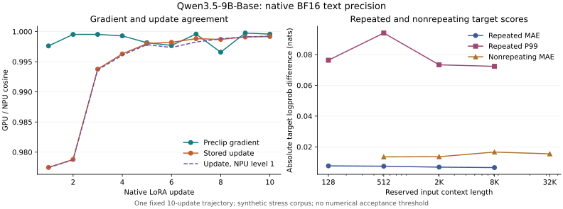

# Qwen3.5-9B-Base text precision evaluation

Completed measurement date: 2026-11-05 Asia/Shanghai (native run IDs retain each host UTC clock).

This release completes the bounded Qwen3.5 text evaluation described below. It combines fresh native captures with separately identified historical framework evidence. Numerical acceptance is **unspecified**; measured differences do not by themselves establish a defect, a successful repair, or general model accuracy.

## Principal findings

Top-1 agreement depends on input design: the repeated-text selection has 264/264 matches, while the nonrepeating structured selection has 45/48. These are bounded selected positions, not model-wide accuracy rates.

High gradient cosine does not imply equal optimizer updates: the first-update gradient cosine is about 0.9976 while stored-update cosine is about 0.9775. Native NPU reset-state noise also changes gradients and updates, so it must be controlled before attribution.

Native NPU deterministic level 1 restores all 24 selected repeat comparisons and the complete ten-update workload’s five-step checkpoint continuation. This improves reproducibility; it does not eliminate cross-platform numerical differences or establish a new operator correctness repair.

## Configuration and identity

- Model revision: `68c46c4b3498877f3ef123c856ecfde50c39f404`; original conditional model, 9,409,813,744 parameters; all 32 language blocks executed.
- Both peers: Transformers 5.20.2, BF16 base weights, native SDPA, original unquantized text path. Four weight shards, config/index and tokenizer files match by full SHA256 (8 files). No model/framework upgrade was performed.
- GPU actual runtime: NVIDIA H20Z, Torch 2.9.0+cu126. The owner designates the cluster H200; measurements identify the actual H20Z runtime.
- NPU actual runtime: Ascend910_9382, Torch 2.9.0+cpu, torch-npu 2.9.0.post2.
- Observed SDPA kernels: GPU `aten::_scaled_dot_product_cudnn_attention`; NPU `npu::npu_fusion_attention_v3`. Fallback convolution and DeltaNet kernels remain native framework paths; timings are not a hardware-only comparison.

## Fresh coverage

| Measurement | Completed scope |
| --- | --- |
| Inputs | 12 discovery, 48 reserved, 6 long sequences; synthetic multilingual/code/prose/structured text |
| Lengths | 128 / 512 / 2,048 / 8,192 / 32,768; six 32K examples |
| Inference | Full versus chunk for 66 inputs; token suffix for 36 short inputs; 216 expected named arrays per peer |
| Selected distributions | 264 full-forward positions, full vocabulary; 32 later fixed-history decode positions |
| Scored reserved targets | 2,304 causal targets over 48 reserved inputs, sampled at start/middle/end |
| Batch / padding | Mixed 65/129-token batch versus singleton; EOS and alternate pad IDs |
| Internal screening | All 32 blocks, final four positions of a 128-token example; 524,288 elements |
| LoRA | 10 updates, five restored updates; all 80 adapter arrays / 671,744 elements; three initialization offsets; seed-0 three repeats |
| Local operators | Four linear-attention layers, two real-input heads, six lengths, zero/nonzero state, chunk/recurrent forward/state/backward; 64 DeltaNet cases plus final norm per peer |
| Performance | Batch-1 cache-off forward, four lengths, two warmups and five synchronized repetitions each |

Synthetic repeated stress sequences are not a representative task benchmark. Four saved prediction rows per input do not imply full-position distribution coverage. The 2,304 target scores are a distinct, more broadly positioned scoring diagnostic.

## Inference results

| Corpus / context | Top-1 matches | Mean tail-merged JS (nats) | P99 JS | Maximum probability error |
| --- | ---: | ---: | ---: | ---: |
| discovery-128 | 24/24 | 3.4655196e-05 | 0.0005487524 | 0.032991817 |
| discovery-512 | 24/24 | 5.8656556e-06 | 5.9478553e-05 | 0.00056956414 |
| reserved-128 | 48/48 | 4.2797314e-06 | 7.7288554e-05 | 0.0098113615 |
| reserved-512 | 48/48 | 1.4037292e-06 | 1.7748496e-05 | 0.0020965101 |
| reserved-2048 | 48/48 | 3.7393403e-07 | 2.977513e-06 | 0.00012662303 |
| reserved-8192 | 48/48 | 8.4117544e-07 | 8.067107e-06 | 0.00040521816 |
| long-32768 | 24/24 | 5.3167531e-07 | 3.5765449e-06 | 0.00025886994 |

Full-forward aggregate: **264/264** top-1 matches; mean JS 4.9863334e-06, P99 5.7147673e-05 nats. Both top-100 sets are queried from full-vocabulary-normalized probabilities and the remaining mass is merged into one tail category.

Fixed-history decode: 32/32 top-1 matches; mean JS 0.00013308833 nats. Every forced token is identical across devices; the subsequent row scores the next token, without autonomous-history divergence.

| Reserved context | Targets | GPU NLL | NPU NLL | Absolute NLL gap | Logprob MAE / P99 |
| --- | ---: | ---: | ---: | ---: | ---: |
| 128 | 576 | 1.4461504 | 1.4455562 | 0.00059417841 | 0.0076504471 / 0.076326952 |
| 512 | 576 | 1.4522117 | 1.4529715 | 0.00075985902 | 0.0074150429 / 0.094019833 |
| 2048 | 576 | 1.3585011 | 1.3577316 | 0.00076946831 | 0.0068161548 / 0.073353175 |
| 8192 | 576 | 1.3348172 | 1.3343703 | 0.00044688219 | 0.0065309507 / 0.072339393 |

Scores use offline FP64 log-softmax of native BF16 logits. NLL is averaged over the explicitly selected targets, not every corpus token. Six controlled-choice probes score full candidate token sequences; they are too small to support broad accuracy claims.

- GPU: repeated inference 2/2 exact comparisons; collector transparency exact=True; largest final-row full/partition logit difference 3.4453125; batch/padding exact comparisons 0/4. Full per-input distributions and coordinates remain in the evidence.
- NPU: repeated inference 2/2 exact comparisons; collector transparency exact=True; largest final-row full/partition logit difference 5.515625; batch/padding exact comparisons 0/4. Full per-input distributions and coordinates remain in the evidence.

### Nonrepeating structured supplement

The original repeated stress corpus is reported separately. A second frozen design contains 12 nonrepeating generated English records, Chinese records and code sequences (three domains × 512/2K/8K/32K). It retains 48 final full-vocabulary distributions plus 576 start/middle/end target scores. Unique numeric values/identifiers prevent exact paragraph repetition; it remains a synthetic stress set, not general task accuracy.

| Context | Top-1 matches | Mean JS (nats) | P99 JS |
| --- | ---: | ---: | ---: |
| 512 | 12/12 | 2.3877681e-05 | 0.00016188524 |
| 2048 | 10/12 | 0.00015588202 | 0.00044411804 |
| 8192 | 11/12 | 8.39609e-05 | 0.00037634443 |
| 32768 | 12/12 | 0.00014733002 | 0.00043496212 |

| Nonrepeating sample / prediction position | GPU top-1 token | NPU top-1 token | GPU first/second margin | NPU first/second margin |
| --- | ---: | ---: | ---: | ---: |
| structured-domain0-8192 / 8190 | 15 | 16 | 0 | 0 |
| structured-domain1-2048 / 2046 | 15 | 19 | 0 | 0 |
| structured-domain1-2048 / 2047 | 15 | 18 | 0 | 0 |

Token IDs and probability margins identify observed argmax changes. No expected task answer is assigned to these distribution rows.

Nonrepeating selected-target NLL: GPU 2.2259471, NPU 2.2242207; absolute gap 0.0017263081, logprob MAE 0.014797803, P99 0.10849319 nats over 576 targets.

## Training: propagation, update and continuation

LoRA rank=2, alpha=4, dropout=0, targets `out_proj/q_proj/v_proj`, FP32 adapters. AdamW lr=1e-4, weight_decay=0, foreach=False, native global norm clip=1.0. Identical coordinate initialization and frozen-base identity are checked. Each short input uses the model’s native causal loss shift.

| Update (0-based) | Gradient cosine | Stored update cosine | Stored update RMSE | After-parameter max error |
| --- | ---: | ---: | ---: | ---: |
| 0 | 0.99761844 | 0.97746181 | 1.5179256e-05 | 0.00019999316 |
| 1 | 0.99952812 | 0.9787888 | 1.4732271e-05 | 0.00039667814 |
| 2 | 0.9995293 | 0.99376736 | 6.5985125e-06 | 0.00049703967 |
| 3 | 0.99929028 | 0.99629306 | 4.6821124e-06 | 0.00058626664 |
| 4 | 0.9981509 | 0.99800811 | 3.3678273e-06 | 0.00059363514 |
| 5 | 0.99771264 | 0.99822001 | 3.0612518e-06 | 0.00059706709 |
| 6 | 0.99958066 | 0.99882591 | 2.4859614e-06 | 0.00060182063 |
| 7 | 0.99657699 | 0.99870202 | 2.6501083e-06 | 0.00061853277 |
| 8 | 0.99976242 | 0.99910716 | 2.2547181e-06 | 0.00064750342 |
| 9 | 0.99958018 | 0.99918421 | 2.0136828e-06 | 0.00066645647 |

Stored updates are each side’s after-minus-before values, reduced in FP64. Gradients are captured before clipping. An update disagreement alone is not evidence of an AdamW defect.

- GPU: own-checkpoint continuation 10/10 exact gradient/parameter comparisons across five updates; reset-state training repeatability 4/4 exact comparisons; frozen parameter version changes 0.
- NPU: own-checkpoint continuation 0/10 exact gradient/parameter comparisons across five updates; reset-state training repeatability 0/4 exact comparisons; frozen parameter version changes 0.

| Reserved initialization offset | Gradient cosine | After-parameter max error |
| --- | ---: | ---: |
| 0 | 0.9990236 | 0.00019998528 |
| 1 | 0.99921518 | 0.00019993933 |
| 2 | 0.99962412 | 0.00019991796 |

Offsets 0/1/2 alter the deterministic adapter initialization and select three reserved batches. They are three one-update contrasts, not three independent ten-update trajectories. Historical Trainer/TRL checkpoint results remain separate, including the earlier unresolved NPU continuation differences.

## Operator attribution

Both sides replay exactly equal real-input capsules and cotangents. The independent reference uses FP64 sequential delta-rule mathematics; native routines retain their FP32 internal recurrence and BF16 outputs. Nonzero initial states are generated by FP64 recurrence, quantized to FP32, then passed with identical values to the reference and native computation. The native input capture on each peer remains available separately.

### NPU repeatability control

The native default-level control has 6/24 exact repeated comparisons; native deterministic level 1 has **24/24**. These span three reserved initialization/input offsets, three repeats each, and gradients/postclip gradients/after-parameters/last logits. Adapter initialization matches exactly.

The level-1 policy is also verified on the complete original ten-update workload: own-checkpoint continuation **10/10** exact comparisons and reset-state repeats **4/4** exact comparisons. Frozen base version changes: 0.

Matched uninstrumented first-update median: level 0 0.80025645 s, level 1 0.82068327 s (2.5525344% change; two warmups and five measurements per policy). This small timing sample is not a general overhead guarantee.

Default-path same-state noise must be separated from cross-platform differences. The execution-policy intervention controls repeatability in this pinned native LoRA case; it does not establish a new mathematical operator repair, identify the responsible backward kernel, or retest the older TRL integration.

| Reserved offset | Level-0 vs GPU gradient / update cosine | Level-1 vs GPU gradient / update cosine |
| --- | ---: | ---: |
| 0 | 0.99905701 / 0.98038328 | 0.99897426 / 0.98048599 |
| 1 | 0.99922562 / 0.98146756 | 0.99920461 / 0.98154642 |
| 2 | 0.99961134 / 0.98160845 | 0.99963312 / 0.98139447 |

### Cache partition diagnosis

The discovery-7 512-token case is replayed at splits 64/128/256/508 with all 32 block boundaries and first-layer module tails. The diagnostic collector reproduces the original full/chunk outputs exactly on both peers. Same-input native projections are additionally compared as one M=512 call versus two M=256 calls.

| Peer | Same-input first QKV max error | Same-input MLP-down max error | Model final-logit max error, split 256 |
| --- | ---: | ---: | ---: |
| GPU | 0 | 0.001953125 | 1.0625 |
| NPU | 0.0078125 | 0.00024414062 | 0.734375 |

This establishes local shape-dependent native arithmetic at fixed input, alongside downstream block propagation. It prevents conflating same-side partition effects with a GPU/NPU defect. The first QKV shape contrast is exact on GPU but nonexact on NPU; MLP-down is nonexact on both. A cache logic defect is not established by these observations.

### Common-input local reference replay

Across the common-input operator inventory: 467 paired arrays / 5873888 elements, cosine 0.999999999948, RMSE 1.1760164e-06, maximum absolute error 0.001953125. Aggregating heterogeneous outputs/states/gradients is descriptive; the per-case report is the diagnostic authority.

- GPU: 65 forward/state/backward reference cases; largest per-case max error 0.060937881 in `final-norm`. The reference is a mathematical precision target, not bitwise expected output. Per-array/case values distinguish quantization from other arithmetic error.
- NPU: 65 forward/state/backward reference cases; largest per-case max error 0.060937881 in `final-norm`. The reference is a mathematical precision target, not bitwise expected output. Per-array/case values distinguish quantization from other arithmetic error.

This bounded screen localizes arithmetic under fixed inputs; it does not prove that any remaining model-level discrepancy is a new library defect. Earlier RMSNorm semantic repair and GEMM/Attention reference evidence are reused for their original environments. No new precision policy is declared a validated overall repair.

## Uninstrumented inference performance

| Context | GPU median (s) | NPU median (s) | GPU tokens/s | NPU tokens/s | Peak allocated GPU / NPU (GiB) |
| --- | ---: | ---: | ---: | ---: | ---: |
| 128 | 0.052936672 | 0.37711631 | 2417.9835 | 339.41783 | 17.607289 / 17.577153 |
| 512 | 0.072753427 | 1.3620415 | 7037.4692 | 375.90632 | 17.692705 / 17.665626 |
| 2048 | 0.14732283 | 5.1044797 | 13901.444 | 401.21621 | 18.05752 / 18.042025 |
| 8192 | 0.53198801 | 19.313885 | 15398.843 | 424.15082 | 19.516962 / 19.548116 |

These are native software-stack observations on synthetic repeated text, batch 1 and one output row, excluding model load and queue time. They do not isolate hardware capability, serving throughput, training speed or a repair’s speed/precision tradeoff.

## Reused evidence and release boundaries

- Existing full-forward 538-position measurements, vLLM prefill/fixed-history decode, SGLang cached inference and BF16/FP16/FP32 contrasts remain valid at their pinned configurations.
- Existing full-parameter SFT, Trainer/TRL LoRA with accumulation, checkpoint/common-state and two-device FSDP2 tests are retained. Fixed-trajectory TRL/verl GRPO and the original clipping/AdamW replay are also retained.
- Existing confirmed zero-centered RMSNorm repair is distinct from later same-input replay and mixed-effect FP32 policy experiments. This release adds numerical evidence, not a new claimed repair.
- Excluded from this text-only release: multimodal paths, quantization, online RL, additional serving scheduler/backend grids, new parallel layouts, three ten-step stochastic seed trajectories and general task accuracy.
- Some historical raw NPU full-SFT/GRPO arrays were removed under earlier cleanup authorization. New release arrays, snapshots and native training checkpoints are retained. Historical scalar evidence is not relabeled as recollected raw data.

## Evidence and reproduction

The reusable protocol is model-precision-evaluation-plan.md [retained private evidence or external source; not bundled]. Private case `projects/torch-gpu-npu/cases/qwen35-report/` contains the full command runbook, token-ID authority, frozen collectors, native receipts, integrity-checked exports, expected-coordinate comparisons and coverage ledger. Shared precision-compare tools supply array, target-score and distribution arithmetic. Connection details and raw traces remain private.

Historical evidence: evaluation and replay index [retained private evidence or external source; not bundled], earlier full-model investigation [retained private evidence or external source; not bundled].

Unified capture index: `compare-qwen35-release-20261104T161239Z`. Offline source and result hashes are retained with the run; a separate new replay directory verifies the numerical summary without another model execution. Thresholds and product acceptance remain null.

Export note: commands mentioning private packages describe the retained private workflow; this aggregate bundle includes only the verifier documented in its root README.
