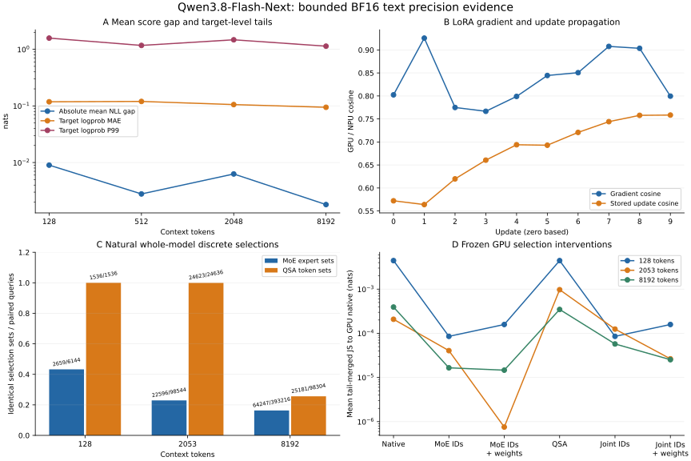

# Qwen3.8-Flash-Next text precision evaluation

Completed measurement and report date: 2026-11-06 Asia/Shanghai. Native IDs retain their host UTC clocks; the primary NPU clock was approximately 3 minutes 42 seconds behind local UTC.

The bounded native capture chain and independent numerical replay are complete. The strict gate verified 26 required core captures and 1,033 exported files; an independent replay verified 1,071 file identities with no findings. All six serving admissions reached retained terminal states and passed exact-worker cleanup. Two NPU engine admissions failed before scoring, so their numerical serving coverage remains missing. Numerical acceptance thresholds remain **unspecified**.

The central finding is configuration-dependent numerical disagreement. GPU automatic placement versus NPU native TP8 gives 254/264 top-1 matches in selected full-forward rows, 2/32 in later fixed-history rows, and 23/48 in the nonrepeating structured supplement. In the separate original automatic-placement LoRA workload, first-update gradient cosine is 0.802406946 and stored-update cosine is 0.572139958. Neither successful execution nor repeatability establishes cross-platform numerical equivalence.

All four figure panels use the **original automatic-placement configuration**, including historical reserved scoring. They do not describe TP8 inference. A compares aggregate NLL gaps with target-level absolute error tails; B distinguishes gradients from actual stored updates; C counts equal discrete sets over all 48 MoE and 12 QSA layers; D compares frozen GPU-selection interventions with GPU native output at each context. Values come from the linked machine-readable evidence. Log scales in A and D preserve the measured positive ranges; connecting lines only aid comparison of measured conditions.

## Identity and execution configurations

- Model: `Qwen/Qwen3.8-Flash-Next`, revision `de4b8e4d43b917e7706784d8bb445c9af86a3540`, native `qwen4_exp` implementation. The complete conditional model has 177,392,830,576 parameters and 48 text blocks; text inference executes the complete backbone. Vision and speculative MTP are outside the tested task.
- Resource verification retains 131 original BF16 shards, 359,999,963,128 payload bytes and 142 verified files. Config SHA256: `889658f2508e8c61d409b02e70e0d78d8d4452ec65aaafbe129805d213d2e74b`; native model source SHA256: `baa79cf3fd27789f159e028ba842459ba4e459e3112bf15e773e6a4d73dc2030`.
- Core runtime: Transformers 5.20.2; GPU NVIDIA H20Z / Torch 2.9.0+cu126; NPU Ascend910_9382 / Torch 2.9.0+cpu / torch-npu 2.9.0.post2. The `+cpu` package label does not mean the NPU workload ran on CPU. Framework integrations use TRL 0.29.0, PEFT 0.20.0 and Accelerate 1.12.0; verl component version is 0.8.0.dev. Engine-specific runtimes are separate below.

| Measurement family | GPU | NPU | Interpretation |
| --- | --- | --- | --- |
| Final inference and structured supplement | Native automatic placement | Native eight-rank TP8, all eight allocated chips, sharded PLE, no CPU parameters | Frozen inputs and identical task-recipe AST; TP reductions and placement differ |
| Core LoRA, determinism, framework/RL, causal and performance | Original automatic placement | Original automatic placement; 51,200,245,760 CPU-resident PLE parameters, text parameters on five NPU devices | Separate from TP8; timings include these residency and native-kernel differences |
| Reserved target-score diagnostic | Original automatic placement | Previously completed automatic-placement capture on the former secondary allocation | Historical evidence reused with actual provenance; no new secondary-host work |
| Serving | Reference automatic placement; GPU engines TP4 | Reference automatic placement; engines attempted native TP8 | Failed native engine admissions supply compatibility evidence only |

Each TP8 rank has 24,013,758,576 physical resident parameter elements, including replicas. Summing these local counts would overstate the logical model size. Model resources, checkpoint bytes and original failures remain retained. New NPU execution after the resource-scope change used only the authorized primary eight-chip allocation.

## Completed scope

| Workload | Actual coverage |
| --- | --- |
| Frozen inference | 66 main inputs; 216 named arrays per peer; six 32K full/chunk pairs; short token-cache, repeat and mixed-padding contrasts; all 48 block tails |
| Nonrepeating supplement | 12 English-record/Chinese-record/code inputs at 512/2K/8K/32K; 24 arrays per peer; three 32K full/chunk pairs; 48 selected distributions and 576 scored targets |
| Reserved scoring | 48 inputs; 2,304 selected causal targets, 576 at each of 128/512/2K/8K; six complete candidate-sequence probes |
| Core LoRA | Ten original updates, five own-checkpoint restored updates, five reserved/reset updates; all 120 adapter arrays and 1,056,768 coordinates |
| Native determinism | Levels 0 and 1; three reserved initialization/input offsets and three repeats; gradient/postclip/after/logit comparisons; level-1 full ten-update continuation |
| Frameworks | Actual Trainer.train and SFTTrainer.train, two updates with two microbatches each, plus checkpoint-1 continuation to update 2, on both peers |
| RL components | Native TRL and verl objective/backward/global-clip/AdamW, four fixed 64+8 trajectories, 26 active actions and all 120 adapter gradient/update arrays |
| Operators and routing | Common-input DeltaNet/final-norm forward/state/backward and FP64 mathematical references; MoE/QSA/PLE/gated-residual diagnostics |
| Causal selection replay | Original complete model; 128/2053/8192 contexts; five GPU-selection interventions per context; all 48 MoE and 12 QSA layers |
| Serving | Two shared prompts, 128/256 tokens; 382 scored targets and eight cached greedy tokens for each successful reference/engine capture; six terminal admissions and cleanup |

These are synthetic stress and diagnostic inputs. Saved final rows do not establish all-position distribution coverage or representative task accuracy. No full-parameter SFT, online RL, GRPOTrainer.train, distributed verl worker loop, multimodal benchmark or quantized-equivalence result is claimed.

## Inference and structured results

This section compares GPU automatic placement against NPU native TP8. Both use the unchanged task-recipe AST and exact frozen inputs; it is a comparison of these two execution configurations.

| Scope | Top-1 matches | Mean tail-merged JS (nats) | P99 JS | Maximum probability error |
| --- | --- | --- | --- | --- |
| Selected full forward | 254/264 | 0.0660446849 | 0.522920364 | 0.995173337 |
| Later fixed forced history | 2/32 | 0.491304429 | 0.632813641 | 0.864424555 |
| Nonrepeating structured | 23/48 | 0.195641052 | 0.65827405 | 0.990673667 |

Each distribution is normalized over the full vocabulary before querying the union of the two top-100 sets and merging remaining mass into one tail category. Top-k values are never renormalized. Fixed-history rows force identical tokens on both peers; the 2/32 count is not autonomous-generation accuracy.

Both peers have 2/2 exact inference repeat comparisons and exact collector transparency. These controls do not remove cross-platform or same-side cache-partition differences. Mixed padded examples have actual lengths 65/128; an attempted slice at 129 remains 128 because the source example ends there.

| Structured context | Targets | Absolute mean NLL gap | Logprob MAE | Logprob P99 |
| --- | --- | --- | --- | --- |
| 512 | 144 | 1.60103694 | 1.77676299 | 7.81405339 |
| 2048 | 144 | 1.42653 | 1.83082038 | 8.39658453 |
| 8192 | 144 | 1.38687864 | 1.50253249 | 8.61513157 |
| 32768 | 144 | 1.35615223 | 1.49448933 | 10.1198319 |

Across all 576 structured targets, GPU NLL is 2.34513459, NPU NLL 3.78778404; absolute gap 1.44264945, MAE 1.6511513, P99 8.96004619 nats. Offline scores use FP64 log-softmax of captured native BF16 logits and explicitly selected target coordinates.

The first native 32K long probe exhausted memory and remains retained. A new attempt with process-local `expandable_segments:True` completed full/chunk 32K in 842.486200/840.145031 seconds. The earlier 8K full/chunk observations were 205.019050/209.562315 seconds. Final inference and structured captures subsequently completed their entire 32K inventories. Short-sequence success or a CPU preflight is not used as long-context evidence.

## Original automatic-placement scoring and training

Reserved scoring is a distinct historical automatic-placement diagnostic. Its small mean gaps must not be used to summarize the final TP8 structured result.

| Context | Targets | Absolute mean NLL gap | Logprob MAE | Logprob P99 |
| --- | --- | --- | --- | --- |
| 128 | 576 | 0.00899750681 | 0.118414697 | 1.57837354 |
| 512 | 576 | 0.002788113 | 0.120063381 | 1.17219493 |
| 2048 | 576 | 0.00628061683 | 0.105677769 | 1.47414637 |
| 8192 | 576 | 0.00180924053 | 0.0946498959 | 1.13697955 |

Averaging can cancel signed token errors. The larger target-level MAE/P99 therefore remain visible alongside the aggregate NLL gaps. Tokens from one synthetic input are correlated; no independent-token population confidence interval is inferred.

Core LoRA uses rank 2, alpha 4, dropout 0 and FP32 adapters on `out_proj/q_proj/v_proj`, with AdamW lr=1e-4, weight_decay=0, foreach=False and native global norm clip=1.0. Initial adapter coordinates match exactly. Frozen-base version changes and nonfinite gradients are zero. Gradients are captured before clipping; stored updates are each side's actual after-minus-before parameter values reduced in FP64.

| Update (zero based) | Gradient cosine | Stored-update cosine | After-parameter maximum error |
| --- | --- | --- | --- |
| 0 | 0.802406946 | 0.572139958 | 0.000199999078 |
| 1 | 0.925720491 | 0.563917779 | 0.000400236386 |
| 2 | 0.774935635 | 0.619739136 | 0.000600107305 |
| 3 | 0.766649163 | 0.66048497 | 0.000789119949 |
| 4 | 0.798964083 | 0.693946262 | 0.000953702984 |
| 5 | 0.84447071 | 0.692903766 | 0.00105497785 |
| 6 | 0.850582335 | 0.720755312 | 0.00120157923 |
| 7 | 0.907700163 | 0.744115183 | 0.00127721747 |
| 8 | 0.903537235 | 0.757872871 | 0.00137682917 |
| 9 | 0.799573023 | 0.758450991 | 0.0015130018 |

Each peer's own-checkpoint continuation has 10/10 exact gradient/after comparisons across five updates; reset repeats have 4/4 exact comparisons. NPU levels 0 and 1 each have 24/24 exact reserved repeat comparisons, and level-1 full-workload continuation/reset remain 10/10 and 4/4. Level 0 was already reproducible in this bounded model workload; level 1 is not credited with repairing randomness.

Matched native first-update medians are 9.71219896 seconds at level 0 and 11.9335512 seconds at level 1, using two warmups and five timed repetitions. They do not establish general deterministic-policy overhead.

## Actual Trainer/SFTTrainer and fixed-trajectory RL

Each Trainer/SFTTrainer family executes the complete text backbone through native `Qwen4ExpForCausalLM`, excluding vision/MTP. Both execute two updates with two microbatches each and native checkpoint continuation. Each family's own-checkpoint result is exact on both peers (2/2 side comparisons). The effective denominator is 20 with valid microbatch target counts 8/12. Across 40 paired targets per family, the absolute mean NLL gap is 0.00293065355, MAE 0.0549848109 and P99 0.485375625 nats.

The initial isolated NPU framework/verl environments lacked required CANN compiler dependencies. Their original failures and failed transports remain retained. Pinning decorator 5.1.1 and scipy 1.13.1 in the isolated environments passed compiler imports and tiny native forward/backward before new model runs completed. This was an environment dependency correction; no model arithmetic replacement is claimed.

TRL and verl below execute native objective components, Torch backward, clip and AdamW on fixed common trajectories. This does not establish GRPOTrainer.train, online learning, distributed rollout or a full verl worker loop. TRL uses its native BF16 selective log-softmax; the explicit verl model-score adapter uses FP32 log-softmax. That configuration difference precedes any interpretation of same-side objective differences.

| Native family | Old-score condition | Gradient cosine | Stored-update cosine |
| --- | --- | --- | --- |
| trl | native-old | 0.58320137 | 0.372105968 |
| trl | clipping-control | 0.609146123 | 0.384398108 |
| verl | native-old | 0.581726531 | 0.372062614 |
| verl | clipping-control | 0.615674955 | 0.388148279 |

The clipping-control condition deliberately shifts selected old scores to exercise the native clip branch; it is not a sampled old policy. Whole-adapter post-step cosine near 0.99972 is dominated by shared starting parameters and must not hide the lower stored-update cosine.

## Operator and discrete-selection diagnosis

Common-input operator replay pairs 467 arrays / 5,929,184 elements. Aggregate cross-platform cosine is 0.999999999979, RMSE 6.55057147e-6, maximum error 0.015625 at final-norm input gradient `[0,1,8353]`. These heterogeneous arrays include forward outputs, recurrent state and gradients; per-case values in the evidence are the diagnostic authority. FP64 sequential mathematical references are computed on CPU and exported diagnostically as FP32. A local reference comparison is not a proof of model-wide equivalence.

The common-input router contrast pairs 24 arrays / 201,056 elements, cosine 0.999999991678 and maximum error 0.03125. Natural whole-model routing has different incoming hidden states; it must be separated from common-input arithmetic. QSA comparisons reconstruct selected-token sets from native Boolean masks, with ascending IDs and padding; they do not expose native top-k rank order.

| Context | Equal MoE expert sets | Equal QSA token sets |
| --- | --- | --- |
| 128 | 2659/6144 | 1536/1536 |
| 2053 | 22596/98544 | 24623/24636 |
| 8192 | 64247/393216 | 25181/98304 |

Five interventions replay frozen GPU MoE IDs, MoE IDs+weights, QSA sets, joint IDs or joint IDs+weights through the original complete native model. ID-only modes recompute weights natively on fixed IDs. Uninstrumented/captured baseline and GPU self-transparency pass; changed NPU counterfactual outputs are expected measurements. All intervention results use the original automatic-placement configuration.

| Context | Native | MoE IDs | MoE IDs + weights | QSA | Joint IDs | Joint IDs + weights |
| --- | --- | --- | --- | --- | --- | --- |
| 128 | 0.00443363924 | 8.5384417e-05 | 0.000158452883 | 0.00443363924 | 8.5384417e-05 | 0.000158452883 |
| 2053 | 0.000208046584 | 4.05484689e-05 | 7.53363568e-07 | 0.000972457507 | 0.000124690417 | 2.64609822e-05 |
| 8192 | 0.000393393114 | 1.65522925e-05 | 1.46450618e-05 | 0.000347070369 | 5.74364446e-05 | 2.52993022e-05 |

Table values are mean tail-merged JS to GPU native (nats), four selected rows per context. MoE interventions reduce the measured gap on these contexts. QSA-only worsens the 2053-token contrast, and joint interventions need not improve monotonically. This supports bounded causal sensitivity to selection; it does not establish a universal hardware defect, a validated mathematical repair, or the cause of the separate TP8 inference discrepancy.

## Native serving admissions and cleanup

| Peer / engine | Torch / TorchNPU | Engine version | Actual result |
| --- | --- | --- | --- |
| gpu / reference | 2.9.0+cu126 / — | Transformers 5.20.2 | completed / exit 0 |
| gpu / vllm | 2.13.0 / — | 0.30.0 | completed / exit 0 |
| gpu / sglang | 2.14.1 / — | 0.5.22 | completed / exit 0 |
| npu / reference | 2.9.0 / 2.9.0.post2 | Transformers 5.20.2 | completed / exit 0 |
| npu / vllm | 2.10.0+cpu / 2.10.0.post4 | 0.30.0+empty | failed / exit 1 |
| npu / sglang | 2.10.0+cpu / 2.10.0.post6 | 0.5.22 | failed / exit 137 |

NPU vLLM 0.30.0+empty fails in native model initialization: the pinned registry routes Ascend into the NVIDIA Qwen4Exp QSA constructor, which raises `NotImplementedError: Qwen4Exp QSA requires FlashAttention`. Read-only package-source diagnosis found no matching NPU QSA route in this pinned path. This is a runtime-specific admission failure, not a universal assertion about every vLLM release.

NPU SGLang 0.5.22 reaches the model/warmup grouped Gemma RMSNorm path, then invokes CUDA JIT at compute_00/sm_00 and the absent `/usr/local/cuda/bin/nvcc`. Retained stderr and hashed source excerpts establish that path. Exit 137 follows child failure and final cleanup; it does not establish OOM. Neither failed engine produced prompt scores or generation; compatibility evidence is not numerical coverage.

GPU native vLLM and SGLang both completed prompt scoring and cached generation after process-local native toolchain search-path corrections. No model/norm/sampling implementation was substituted. The native Transformers reference completed on each peer. All six selected native runs have terminal exports and exact per-run worker cleanup receipts; fresh independent process audits found no owned serving workers on either host.

| Successful prompt comparison | Targets | Absolute mean NLL gap | Logprob MAE | Logprob P99 |
| --- | --- | --- | --- | --- |
| gpu-serving-reference__gpu-serving-vllm | 382 | 0.03534463 | 0.0888631693 | 1.36891831 |
| gpu-serving-reference__gpu-serving-sglang | 382 | 0.0290499996 | 0.0935292725 | 1.54473335 |
| gpu-serving-reference__npu-serving-reference | 382 | 0.0182843457 | 0.0888944847 | 1.52130695 |

All successful comparisons match both eight-token generated histories in this two-prompt sample. Only equal chosen-token prefixes are eligible for decode-score comparison; later divergent histories would be excluded. These receipts do not establish scheduler throughput, full-distribution agreement or NPU engine equivalence.

## Uninstrumented automatic-placement performance

| Context | GPU median seconds | NPU median seconds |
| --- | --- | --- |
| 128 | 0.885278191 | 6.98744369 |
| 512 | 3.10238731 | 20.5502294 |
| 2048 | 11.9922169 | 69.3723278 |
| 8192 | 48.1663047 | 264.076573 |

These are batch-1 cache-off native forwards with two warmups and five synchronized repetitions, excluding model load and queue time. Original automatic placement, CPU PLE residency and native fallback kernels differ; the table is not a hardware-only speed ratio, serving throughput result or TP8 speedup claim.

## Evidence, independent replay and release limits

The [public machine-readable evidence](../sources/qwen38-precision-20261106.json) retains selected numerical sections, all compared runtime versions, 53 provenance exports, resource/input/source hashes and native admission/cleanup status. Full traces, source locations, raw arrays, token datasets and connection details stay in the private case. [Evaluation history](../sources/model-evaluations.json) pins a separate local measurement Git revision; the model revision is not used as the measurement archive. These files are prepared locally and have not been pushed or published.

- Private unified index: `compare-qwen38-release-20261104T235617Z`.
- Final analysis: `compare-qwen38-analysis-20261105T171600Z`; fresh independent replay: `compare-qwen38-replay-20261105T171747Z`.
- Strict gate: `compare-qwen38-verification-20261105T171936Z`; 26 successful core captures, 1,033 hash-verified exported files, 1,071 replay identities, zero findings; acceptance null.
- All three numerical JSON outputs are byte-identical between analysis and replay. Analysis SHA256: `cfdddf4974750b5da7bf44f11f38da765481abec4df6ba4f8e0be27faf3abb21`.
- Serving analysis and independent serving replay: `compare-qwen38-serving-analysis-20261105T171941Z` / `compare-qwen38-serving-replay-20261105T171941Z`; byte-identical JSON SHA256: `0d8f7fc16c3d4dc0836b89cf41860fbc50f6c5344cfcfb2fcac7c2adf1de70db`.
- Fresh final review `compare-qwen38-final-report-review-20261105T173053Z` rechecked the 1,071-file frozen identity, absent exact local continuation owners, original-host native terminals and both independent exact-worker cleanup audits. It submitted no model workload.
- Public regressions: 517 passed, 10 optional skips. Available private CPU regressions: 55 passed. Four Torch-dependent private modules and local installation smoke were unavailable because this local interpreter lacks Torch; native model tests and their retained receipts are separate.

The final review corrected offline resolution of the selected structured retry in both numerical analysis and the target inventory. Regression fixtures preserve the failed original capture byte-for-byte and prove that 576 selected targets pass while 575 fail. Independent replay and strict gates above ran after that correction. Failed model/transport attempts remain unmodified.

The reusable evaluation protocol [retained private evidence or external source; not bundled], private case `RUNBOOK.md` and frozen commands describe collection and replay. Do not restart the completed continuation: doing so rewrites selection manifests pinned by the final identity. Further validation must use a fresh recorded run. Completion here means the bounded capture, diagnosis, replay and reporting task is closed with explicit NPU serving gaps; no numerical acceptance, general accuracy claim or universal repair has been inferred.

Export note: commands mentioning private packages describe the retained private workflow; this aggregate bundle includes only the verifier documented in its root README.
